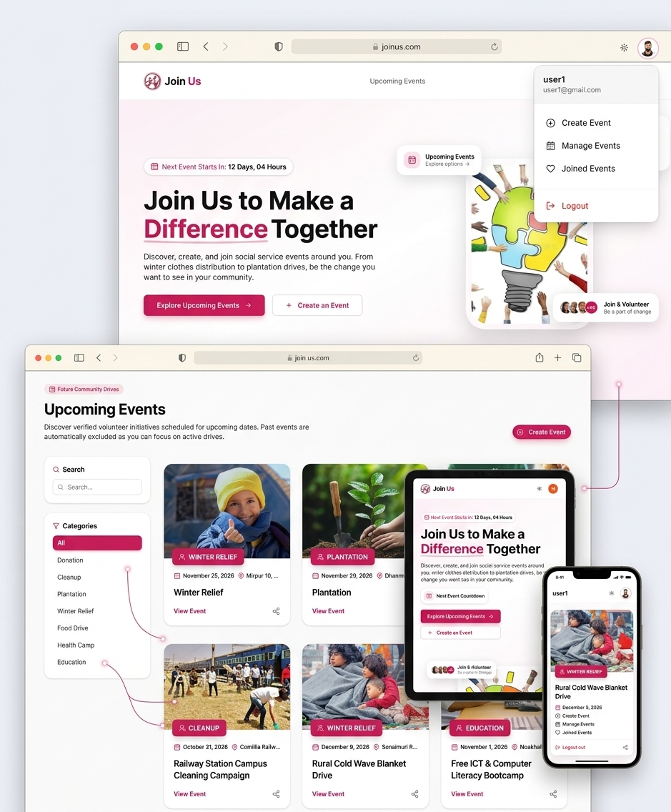

  

  # JoinUs - Social Development Events Platform

  **A community-driven event management platform where users can create, join, and track social service events in their local area.**

  [Live Website](https://join-up-sigma.vercel.app) • [Server Repository](https://github.com/naderarrahman/JoinUp-Server) • [Client Repository](https://github.com/naderarrahman/JoinUp)

---

## 📖 About The Project

**JoinUs** is designed to connect passionate individuals with local community service opportunities. Whether it's a winter clothes distribution, a tree plantation drive, or an environmental cleanup, JoinUs provides the tools to organize, participate, and track the impact.

This project is a full-stack application built with **Next.js** for the frontend and **Express.js** for the backend. It features secure authentication, robust state management, and a seamless user experience across all devices.

---

## ✨ Key Features

- **🔐 Secure Authentication:** Email/Password and Google OAuth login using BetterAuth with JWT integration for API protection.
- **📅 Event Management:** Users can easily create, update, and delete their own social service events.
- **🤝 Join & Track Events:** Browse upcoming events, join drives with a single click, and track all joined events in a dedicated dashboard.
- **⏱️ Smart Time Management:** Events automatically transition from "Upcoming" to "Past/Ended" based on the current date, updating the UI dynamically.
- **🎨 Modern & Responsive UI:** A beautiful, highly responsive design featuring a dynamic Bento-grid gallery, glassmorphism elements, and Dark/Light mode toggling.
- **🔒 Protected Routes:** Private routes (Create, Manage, Joined) are secured using Next.js Middleware (`proxy.ts`) and JWT verification on the Express backend.

---

## 💻 Tech Stack

**Frontend:**
- Next.js 14+ (App Router)
- TypeScript
- Tailwind CSS & Shadcn UI
- BetterAuth (Client)
- Lucide React (Icons)

**Backend:**
- Express.js
- TypeScript
- MongoDB (Atlas)
- JWT (JSON Web Tokens) & JWKS

**Deployment:**
- Frontend & Backend: Vercel
- Database: MongoDB Atlas

---

## 🚀 Getting Started (Local Setup)

Follow these steps to run the project locally on your machine.

### Prerequisites
- Node.js (v18 or higher)
- MongoDB Atlas account
- Git

### 1. Clone the Repositories

    # Clone the client
    git clone https://github.com/naderarrahman/JoinUp-Client.git

    # Clone the server
    git clone https://github.com/naderarrahman/JoinUp-Server.git

### 2. Server Setup

    cd JoinUp-Server
    npm install

Create a `.env` file in the root of the server directory and add the following:

    PORT=5000
    MONGODB_UN=your_mongodb_username
    MONGODB_PASS=your_mongodb_password
    CLIENT_URL=http://localhost:3000

Run the server:

    npm run dev

### 3. Client Setup

    cd JoinUp-Client
    npm install

Create a `.env.local` file in the root of the client directory and add the following:

    BETTER_AUTH_SECRET=your_better_auth_secret
    BETTER_AUTH_URL=http://localhost:3000
    MONGODB_URI=your_mongodb_connection_string
    GOOGLE_CLIENT_ID=your_google_client_id
    GOOGLE_CLIENT_SECRET=your_google_client_secret
    NEXT_PUBLIC_API_URL=http://localhost:5000
    NEXT_PUBLIC_APP_URL=http://localhost:3000

Run the client:

    npm run dev

The application will be running at `http://localhost:3000`.

---

## 📁 Project Structure

### Client (Next.js)

    JoinUp-Client/
    ├── public/                 # Static assets (logo, images)
    ├── src/
    │   ├── app/                # Next.js App Router (Pages & Layouts)
    │   │   ├── create-event/   # Private Route: Create Event Form
    │   │   ├── events/         # Public Route: Event Details
    │   │   ├── joined-events/  # Private Route: User's joined events
    │   │   ├── manage-events/  # Private Route: Manage created events
    │   │   ├── sign-in/        # Auth: Login page
    │   │   ├── sign-up/        # Auth: Register page
    │   │   ├── layout.tsx      # Root layout (Navbar, Footer)
    │   │   └── page.tsx        # Home Page (Hero, Recent Events, Gallery)
    │   ├── components/         # Reusable UI Components
    │   │   ├── ui/             # Shadcn UI components
    │   │   ├── EventCard/      # Event related cards & forms
    │   │   ├── AvaterFunctionality/ # Manage/Joined/Edit/Delete Modals
    │   │   └── Home/           # Home page sections
    │   ├── lib/                # Utilities & Configurations
    │   │   ├── auth.ts         # BetterAuth Server Config
    │   │   ├── auth-client.ts  # BetterAuth Client Config
    │   │   ├── getToken.ts     # JWT token fetchers
    │   │   └── utils.ts        # Tailwind/Class utils
    │   └── proxy.ts            # Next.js Middleware for route protection
    ├── .env.local              # Local Environment Variables
    └── package.json

### Server (Express.js)

    JoinUp-Server/
    ├── src/
    │   └── server.ts           # Main Express server file (APIs & Middleware)
    ├── .env                    # Server Environment Variables
    ├── tsconfig.json           # TypeScript Configuration
    ├── vercel.json             # Vercel Deployment Configuration
    └── package.json

---

## 👨‍💻 Author & Contact

**Nader Ar Rahman**

- **LinkedIn:** [linkedin.com/in/naderarrahman](https://www.linkedin.com/in/naderarrahman/)
- **Email:** [naderarrahman@gmail.com](mailto:naderarrahman@gmail.com)

---

  
Made with ❤️ for the community.

